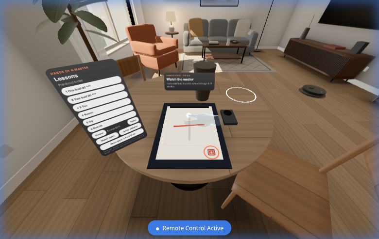
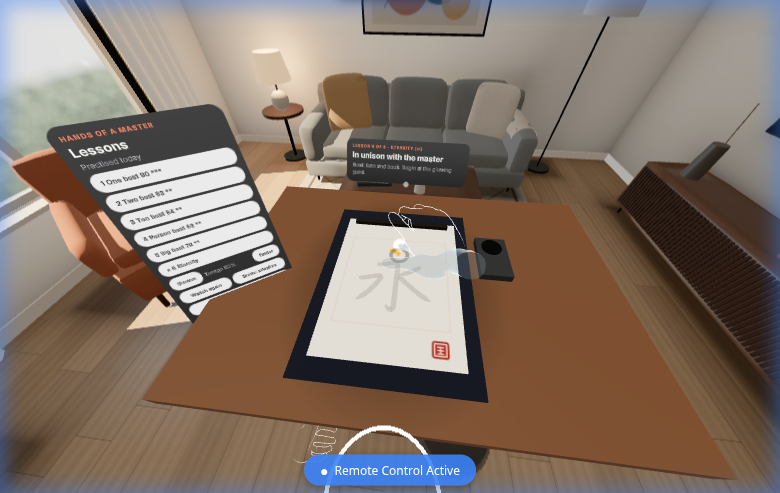
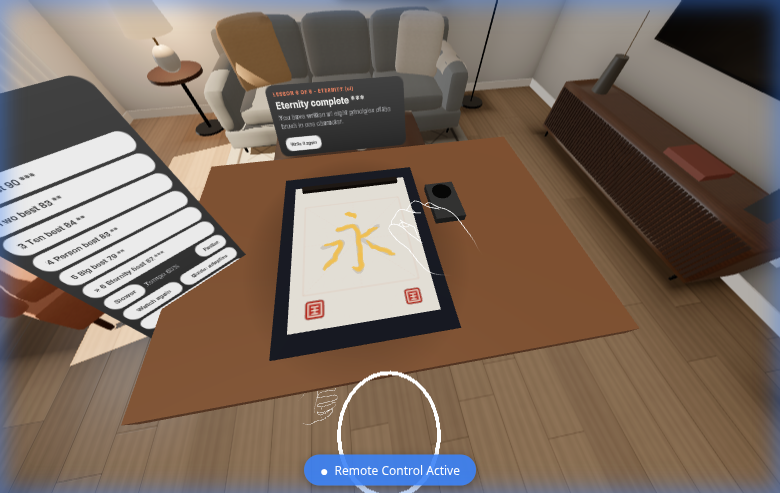

# Hands of a Master

**Mixed reality calligraphy for Meta Quest, hands only.** A master's translucent "ghost" hand appears on your real desk and writes beside you, stroke by stroke. You follow it with your own fingertip on real paper-sized space. Stay in step and the two hands lock together in gold. As you improve, the master fades away and lets you write alone.



| | |
|---|---|
|  |  |

- **Platform:** WebXR in Meta Quest Browser (Quest 3 / 3S), built with the Immersive Web SDK (IWSDK) 1.1.0. No install: judges open a URL.
- **Competition:** Meta VR Start Developer Competition 2026. Suggested track: Productivity (learning a skill). Division: New Experience.
- **Status (16 Nov 2026):** the full loop is built and passes an automated end-to-end test in the IWSDK emulator. It has not yet been run on a physical headset; see [docs/TESTING.md](docs/TESTING.md).

## The experience (about 5 to 10 minutes)
1. **Start at my desk.** In the browser page, press the button (or the browser's Enter XR). You stay seated, and passthrough shows your real room.
2. **The paper arrives on your real table.** The app finds a table among the detected planes and unrolls a felt mat, washi paper with a practice grid, a paperweight and an inkstone in front of you, anchored in place. Round tables are handled. If there is no table, it falls back to a virtual desk.
3. **Watch the master.** The ghost hand writes the character in vermilion ink, with a soft light at its fingertip.
4. **Touch the red seal** once. This calibrates contact height for your desk.
5. **Write stroke by stroke.**
   - The master waits at a glowing start point and leads at your chosen tempo.
   - A shrinking ring under your fingertip shows where the ink will land.
   - Touch the desk to put ink down and lift to finish. Ink width follows your speed, with a dry-brush texture.
   - Stay within about 2.4 cm of the master's fingertip and **your hands lock together**: the ghost slides onto your tracked hand, turns gold, a bell rings, and your ink turns gold.
   - Each stroke is scored on path, direction, order, speed and sync, with a specific hint when it misses ("Other direction", "Stay closer to the master's path", "Slower").
6. **Seal it.** The master's seal is stamped onto the page and your score and daily streak are saved. Then choose "Next lesson" or "Write it again".

**Lessons:** 一 one, 二 two, 十 ten, 人 person, 大 big, 永 eternity. 永 is the classic teaching character whose five strokes contain the Eight Principles of the brush.

**Coming back:** best score per character, stars, and a daily practice streak. Your best score also drives the **adaptive guide**: the ghost and tracing outline fade as you improve ("the master lets go").

**Controls (all hands):**
- Write with your index fingertip.
- **Poke** menu buttons with a fingertip, or **pinch** with the hand ray.
- Menu options:
  - lessons;
  - tempo (30 to 100%);
  - watch again;
  - guide mode (adaptive / always / off);
  - "Move paper in front of me" (places the paper again).
- Left-handed writers are detected automatically. The ghost becomes a left hand and the menu moves to the right side.

## Run it
```bash
npm ci            # Node >= 20.19 (see .nvmrc). .npmrc skips onnxruntime's CUDA download (Linux).
npm run setup     # once per machine: AI-agent MCP configs + IWSDK reference index (optional)
npm run dev       # HTTPS dev server + IWER emulator at https://localhost:8081
npm run build     # static site in dist/ (deploy to Vercel; vercel.json is included)
```
- **On a Quest (Linux or Windows):** connect over USB, run `adb reverse tcp:8081 tcp:8081`, then open `https://localhost:8081` in Quest Browser. Alternatively, open the Network URL from the dev server on the same Wi-Fi.
- **Deploy:** `npx vercel --prod` from this folder. Use the production alias URL for judges and test it logged-out on the headset.

## Test it
- **Automated end-to-end:** `python3 tools/e2e.py --lessons 6 --negative` with the dev server running. It plays every lesson hands-only in the emulator, checks that the wrong strokes get the right hints, and saves screenshots.
- Results, the on-device checklist and known gaps are in **[docs/TESTING.md](docs/TESTING.md)**.

## Documents
| File | What |
|---|---|
| [docs/JUDGING.md](docs/JUDGING.md) | How the app meets each judging criterion, rule and special award, with evidence and known gaps |
| [docs/SUBMISSION.md](docs/SUBMISSION.md) | Devpost text, video shot list (under 3 min), screenshot list, final checklist |
| [docs/TESTING.md](docs/TESTING.md) | Automated and manual tests, latest results, performance numbers, on-device plan |
| [.claude/skills/quest-hands-first-webxr/SKILL.md](.claude/skills/quest-hands-first-webxr/SKILL.md) | Reusable playbook for the other projects: workflow, proven patterns, emulator test harness, pitfalls |
| [docs/IWSDK-STARTER.md](docs/IWSDK-STARTER.md) | Notes from the IWSDK starter this project began from |

## Code map
| File | Role |
|---|---|
| `src/calligraphy-system.ts` | The experience: placement, watch, calibrate, practice, complete; fingertip tracking; poke buttons; captions and menu |
| `src/ghost/ghost-pose.ts` | Builds the master's 25-joint hand pose for any fingertip target on the paper (from IWER's "point" pose) |
| `src/ghost/ghost-hand.ts` | Skinned ghost hand: Fresnel shader, depth pre-pass, fingertip glow; joint blending for lock-in |
| `src/ink/ink-ribbon.ts` | Preallocated brush-stroke ribbons: taper, speed-based width, dry-brush alpha |
| `src/lessons/` | Lessons, stroke timing (`master-path.ts`), scoring and hints (`scoring.ts`), generated `strokes.json` |
| `src/desk/desk.ts` | Writing set: mat, paper texture with practice grid, paperweight, inkstone, seal, hover cursor, virtual table |
| `src/common/` | One Euro filter, synthesized sound (Web Audio, no audio files), 72 Hz + foveation |
| `src/progress.ts` | localStorage progress: best scores, attempts, streak |
| `tools/build-data.mjs` | `npm run data`: KanjiVG SVGs to `strokes.json`; IWER point pose to `point-pose.json` |
| `tools/e2e.py` | Emulator end-to-end test (see docs/TESTING.md) |

To add a character, drop its KanjiVG SVG into `tools/kanjivg/`, run `npm run data`, and add a line to `LESSONS` in `src/lessons/lessons.ts`. The pipeline works for any stroke-ordered script.

## Credits
- **Stroke order and shapes:** [KanjiVG](https://kanjivg.tagaini.net), CC BY-SA 3.0, (c) Ulrich Apel and contributors. The derived `src/lessons/strokes.json` is under the same license.
- **Hand mesh:** [WebXR Input Profiles](https://github.com/immersive-web/webxr-input-profiles) generic hand, MIT.
- **Base hand pose:** [IWER](https://github.com/meta-quest/immersive-web-emulation-runtime) point pose, MIT, (c) Meta Platforms.
- **Built with:** the [Immersive Web SDK](https://github.com/facebook/immersive-web-sdk) (MIT) and three.js (super-three). Sounds are synthesized in code.
- **Common plan for all six team projects:** `../meta-vr-start-2026-kit/research/common-build-plan.md`.
